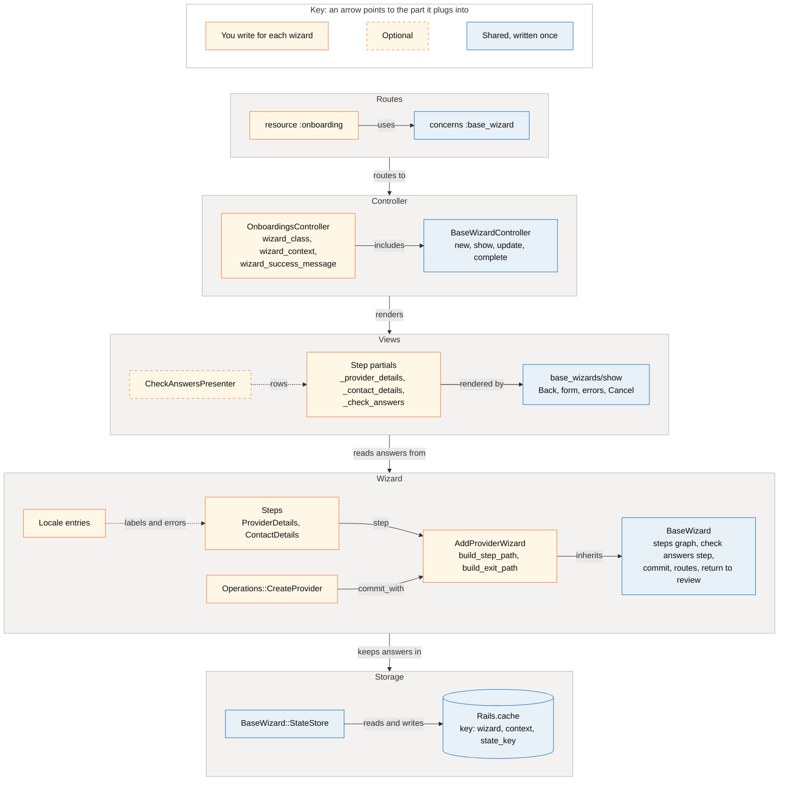

# BaseWizard

`BaseWizard` is a base class for a common kind of [dfe-wizard](https://github.com/DFE-Digital/dfe-wizard): one or more form pages in a fixed order, a check answers page, and a single save at the end. A subclass declares its steps, its commit operation and two path methods. The base class sets up everything else.

For dfe-wizard in general, see [wizards.md](wizards.md).

## Why it exists

dfe-wizard is built for journeys that branch. A journey that does not branch still needs all of its parts set up by hand. Before this class, the Support add user wizard had about 200 lines of setup and 60 lines of logic that were specific to adding a user. The setup was:

- a wizard class with a steps graph, a steps operator, a route strategy and the return-to-review hooks
- a cache repository and an empty state store
- an empty check answers step
- a controller with `new`, `show` and `update` actions and the wiring between them
- a `show` view and three routes

Each new journey of this kind copied all of that again.

Older journeys of this kind use `BaseForm` and `Stores::*` instead. Those keep answers in one stash for each user and form. If someone runs the same journey in two tabs, the tabs share one stash and overwrite each other. `BaseWizard` gives each journey its own `state_key`, so tabs stay apart.

## When to use it

Use it when all of these are true:

- The steps always come in the same order. No answer changes which step comes next.
- The journey ends on a check answers page.
- Nothing is saved to the database until the user confirms on check answers.
- The answers fit in the cache for up to 24 hours.

Good examples are adding a user and onboarding a provider.

## When not to use it

- **The journey branches.** For example, "if they pick X, skip step 3". Use dfe-wizard directly, as the course wizard and the A levels wizard do. Do not add branching to the base class, because that would rebuild the gem.
- **There is no check answers page.** The commit runs on check answers. A journey that saves on its last form page is a different shape.
- **Each page saves as you go.** Edit pages that update a record on every submit do not need a wizard.
- **The check answers page needs other actions.** An example is removing an item from a list. You can add an action to your controller that writes to `wizard.state_store`, but the base class does not help with it.
- **The form starts from an existing record.** An edit journey needs the first page filled from the record. There is no hook for this yet.

## The parts

Each row is one layer of a wizard. The parts you write for each wizard are on the left, and the shared parts they plug into are on the right. The diagram uses provider onboarding as the example.



## What the base class does for you

| Part | Where | What it does |
|---|---|---|
| Steps graph | `BaseWizard#steps_processor` | Chains your steps in order, then `:check_answers`, then `:exit`. |
| Check answers step | `BaseWizard::CheckAnswers` | A step with no fields. |
| Commit | `BaseWizard#steps_operator` | Runs your commit operation when check answers is submitted. Form steps use the gem defaults, validate then persist. |
| State store | `BaseWizard::StateStore` | The gem state store, with an accessor for each step attribute. |
| Repository | `BaseWizard.repository_for` | A `Rails.cache` repository. The key is the wizard class, the context values sorted by key, and the `state_key`. Answers expire after 24 hours. |
| Routes for steps | `BaseWizard#route_strategy` | Calls your two path methods. |
| Change links | `#change_path`, `#handle_return_to_review`, `#handle_back_to_review` | A Change link adds `return_to_review` to the URL. Continue and Back then return to check answers, if every step before it is valid. |
| Empty submits | `#extract_step_params_from_request` | Check answers posts no step params. This stops the gem from raising on that. |
| Controller actions | `BaseWizardController` | `new` starts a journey with a new `state_key` and redirects to the first step. `show` renders a step. `update` saves the step, then goes to the next step or commits. A step in the URL that has no page, such as a mistyped step or `exit`, gives a 404. |
| Page layout | `app/views/base_wizards/show.html.erb` | Back link, form, error summary, the step partial and a Cancel link. |
| Routes | `concerns :base_wizard` in `config/routes.rb` | `new`, plus `GET` and `PATCH` on `wizard/:state_key/:step`. |

## What you write

| Part | Notes |
|---|---|
| Step classes | One for each form page. Attributes, validations and `permitted_params`. |
| A commit operation | Reads the answers and saves the record. Puts errors on the step if the save fails. |
| The wizard subclass | `step` for each page, `commit_with`, `build_step_path` and `build_exit_path`. |
| The controller | Includes `BaseWizardController` and defines `wizard_class`, `wizard_context` and `wizard_success_message`. |
| One routes line | `concerns :base_wizard, controller: "..."` inside a `resource` or `resources` block. |
| Step partials | One for each form step, and one for check answers. |
| A check answers presenter | Gives the rows of the check answers page. Optional, but it saves building each row by hand. |
| Error messages | Under the step class names in `config/locales/en.yml`. |
| Specs | Step specs for validations, and a system spec for the journey. |

## Assumptions

- **Attribute names are unique across the steps of a wizard.** The gem stores every answer in one flat hash, and finds the step for an attribute by its name. Two steps with an `email` attribute would overwrite each other.
- **Answers live in `Rails.cache`.** Production uses Solid Cache, which every pod shares. In development the cache is `:null_store` unless you run `bin/rails dev:cache`. With `:null_store`, every answer is lost between requests. The pages still move forward, but check answers shows empty values and the commit has no answers to save.
- **Answers are not cleared on Cancel.** They expire after 24 hours. They are cleared after a successful commit.
- **The context identifies the scope of the journey.** `wizard_context` must give the same hash on every request of a journey, usually from route params. Its values go into the cache key.
- **The route params are `state_key` and `step`.** The routes concern gives these. If you write the routes by hand, use the same names.
- **Step partials are at `<controller_path>/steps/_<step_id>.html.erb`.** The check answers partial is `_check_answers.html.erb`.
- **The form scope is the step id.** Params arrive as `params[:provider_details]`, not as a model param key.
- **Continue and Back return to check answers only when every step before it is valid.** If a Change link is followed on a journey with a step that is empty or no longer valid, Continue and Back go to the next or previous step instead.

## Step by step: provider onboarding

This walks through `Support::AddProviderWizard`. It has two form pages, provider details and contact details, then check answers. When the user confirms, it creates a provider in the recruitment cycle.

### 1. Write a step class for each page

A step includes `DfE::Wizard::Step`, declares its attributes and validations, and lists its `permitted_params`. The step can reach the wizard through `wizard`.

```ruby
# app/wizards/support/add_provider_wizard/steps/provider_details.rb
class Support::AddProviderWizard
  module Steps
    class ProviderDetails
      include DfE::Wizard::Step

      attribute :provider_name, :string
      attribute :provider_code, :string
      # ...

      validates :provider_name, presence: true, length: { maximum: 100 }
      validate :provider_code_taken

      def self.permitted_params
        %i[provider_name provider_code ukprn accredited accredited_provider_number provider_type urn]
      end

    private

      def provider_code_taken
        return if provider_code.blank?

        errors.add(:provider_code, :taken) if Provider.exists?(recruitment_cycle: wizard.recruitment_cycle, provider_code: provider_code.upcase)
      end
    end
  end
end
```

`Steps::ContactDetails` follows the same pattern for email, telephone, website and address. Its attribute names do not repeat any in `ProviderDetails`.

Keep form values as strings where the view compares them. For example, the radio buttons for `accredited` use `"1"` and `"0"`, so the attribute is `:string` and `accredited?` casts it.

### 2. Write the commit operation

The operation runs when check answers is submitted. `@wizard.step(:id)` gives a step filled from the saved answers. Return `{ success: true }` when it saves. Otherwise, copy the errors onto the step, so that check answers shows them.

```ruby
# app/wizards/support/add_provider_wizard/operations/create_provider.rb
class Support::AddProviderWizard
  module Operations
    class CreateProvider
      def initialize(repository:, step:)
        @step = step
        @wizard = step.wizard
      end

      def execute
        provider = @wizard.recruitment_cycle.providers.new(provider_attributes)

        if provider.save
          @wizard.created_provider = provider
          { success: true }
        else
          provider.errors.full_messages.each { |message| @step.errors.add(:base, message) }
          { success: false, errors: @step.errors }
        end
      end

    private

      def provider_attributes
        provider_details = @wizard.step(:provider_details).serializable_data
        contact_details = @wizard.step(:contact_details).serializable_data

        provider_details
          .merge(contact_details)
          .merge("organisations_attributes" => [{ name: provider_details["provider_name"] }])
      end
    end
  end
end
```

The `repository:` argument is part of the gem's operation interface. You can ignore it.

### 3. Write the wizard

Declare the steps in order, the commit operation, and the two path methods. `context` holds the values from `wizard_context` in the controller. `state_key` is the key of this journey.

```ruby
# app/wizards/support/add_provider_wizard.rb
module Support
  class AddProviderWizard < BaseWizard
    step :provider_details, Steps::ProviderDetails
    step :contact_details, Steps::ContactDetails
    commit_with Operations::CreateProvider

    attr_accessor :created_provider

    def recruitment_cycle
      @recruitment_cycle ||= RecruitmentCycle.find_by!(year: context[:recruitment_cycle_year])
    end

    def build_step_path(helpers, step_id, **options)
      helpers.wizard_support_recruitment_cycle_providers_onboarding_path(
        context[:recruitment_cycle_year],
        state_key:,
        step: step_id,
        **options,
      )
    end

    def build_exit_path(helpers)
      helpers.support_recruitment_cycle_providers_path(context[:recruitment_cycle_year])
    end
  end
end
```

`build_step_path` must pass `**options` on. That is how Change links add `return_to_review`. The exit path is where Back goes from the first step, and where Cancel goes.

`recruitment_cycle` and `created_provider` are specific to this wizard. Add methods like these when steps or the operation need shared data.

### 4. Write the controller

Include the concern and define three methods. Override `wizard_completed_path` when the journey must end somewhere other than the exit path. Onboarding goes to the new provider.

```ruby
# app/controllers/support/providers/onboardings_controller.rb
module Support
  module Providers
    class OnboardingsController < ApplicationController
      include BaseWizardController

      before_action :recruitment_cycle

    private

      def wizard_class = AddProviderWizard

      def wizard_context = { recruitment_cycle_year: params[:recruitment_cycle_year] }

      def wizard_success_message = "Organisation added"

      def wizard_completed_path
        support_recruitment_cycle_provider_path(params[:recruitment_cycle_year], wizard.created_provider)
      end
    end
  end
end
```

The views can use `wizard`, `current_step` and `current_step_name`.

### 5. Add the routes

Use the concern inside a `resource` or `resources` block.

```ruby
# config/routes/support.rb
namespace :providers do
  resource :onboarding, only: [] do
    concerns :base_wizard, controller: "onboardings"
  end
end
```

This gives:

| Helper | Path | Action |
|---|---|---|
| `new_support_recruitment_cycle_providers_onboarding_path` | `/support/:year/providers/onboarding/new` | `new` |
| `wizard_support_recruitment_cycle_providers_onboarding_path` | `/support/:year/providers/onboarding/wizard/:state_key/:step` | `show`, `update` |

Link to the `new` path to start a journey.

### 6. Write the step partials

Put one partial for each step in `app/views/support/providers/onboardings/steps/`. The shared layout gives the Back link, the form, the error summary and Cancel. A partial gets `form` and holds the page title, heading, fields and submit button.

```erb
<%# _provider_details.html.erb %>
<%= render PageTitle.new(title: "support.providers.onboardings.new", has_errors: current_step.errors.any?) %>

<h1 class="govuk-heading-l">
  <span class="govuk-caption-l">Add organisation</span>
  Organisation details
</h1>

<%= form.govuk_text_field :provider_name, label: { text: "Provider name", size: "s" } %>
<%# ... %>

<%= form.govuk_submit %>
```

For the check answers rows, write a presenter that includes the gem's `DfE::Wizard::CheckAnswersPresenter`. `rows_for` gives a row for each attribute. Each row has a `label` from `human_attribute_name`, a `formatted_value` and a `change_path` that already includes `return_to_review`. Override `format_value` to change how a value shows.

```ruby
# app/wizards/support/add_provider_wizard/check_answers_presenter.rb
class Support::AddProviderWizard
  class CheckAnswersPresenter
    include DfE::Wizard::CheckAnswersPresenter

    def contact_rows
      rows_for(:contact_details, %i[email telephone website full_address])
    end

    # "Email address" becomes "email address", for the Change link.
    def visually_hidden_text(row)
      row.label.sub(/\A[A-Z](?=[a-z])/, &:downcase)
    end
  end
end
```

Put the labels under the step class names in `config/locales/en/activemodel.yml`:

```yaml
en:
  activemodel:
    attributes:
      support/add_provider_wizard/steps/contact_details:
        email: Email address
```

The check answers partial renders the rows:

```erb
<%# _check_answers.html.erb %>
<% presenter = Support::AddProviderWizard::CheckAnswersPresenter.new(wizard) %>

<%= render GovukComponent::SummaryListComponent.new do |component|
      presenter.contact_rows.each do |answer|
        component.with_row do |row|
          row.with_key(text: answer.label)
          row.with_value(text: answer.formatted_value)
          row.with_action(text: "Change", href: answer.change_path, visually_hidden_text: presenter.visually_hidden_text(answer))
        end
      end
    end %>

<%= form.govuk_submit(t("support.providers.add")) %>
```

### 7. Add the error messages

Errors are looked up under the step class name.

```yaml
en:
  activemodel:
    errors:
      models:
        support/add_provider_wizard/steps/provider_details:
          attributes:
            provider_name:
              blank: "Enter a provider name"
```

### 8. Write the specs

- **Step specs** in `spec/wizards/support/add_provider_wizard/steps/`. Mark them `type: :model` to use shoulda-matchers. A step that calls `wizard` needs a real wizard:

  ```ruby
  let(:wizard) do
    Support::AddProviderWizard.new(state_key: "spec", context: { recruitment_cycle_year: recruitment_cycle.year })
  end

  subject(:wizard_step) { described_class.new(**params, wizard:) }
  ```

- **A system spec** for the journey, including Change and Back from check answers. URLs contain a `state_key`, so match them with a pattern: `have_current_path(%r{/providers/onboarding/wizard/[^/]+/contact_details\z})`.

You do not need specs for the graph, routes, cache or controller actions. `spec/wizards/base_wizard_spec.rb` covers those.

## Implemented wizards

- `Support::AddUserWizard`: one step, `details`. Routes under `/support/:year/users`.
- `Support::AddProviderWizard`: two steps, `provider_details` and `contact_details`. Routes under `/support/:year/providers/onboarding`.

## Limitations and gotchas

### Routes

- **One wizard for each resource.** The concern always uses the route name `wizard_<resources>` and the path `wizard/:state_key/:step`. A second wizard on the same resource stops the app from booting:

  ```ruby
  resources :users, only: [] do
    concerns :base_wizard, controller: "add_user_wizards"
    concerns :base_wizard, controller: "invite_user_wizards"
  end
  # ArgumentError: Invalid route name, already in use: 'wizard_users'
  ```

- **The concern replaces the `new` action of the resource, with no error.** The concern is drawn first, so it takes `/users/new` and the `new_user` name. The `new` route of the resource stays in the route table, but no request can get to it:

  ```ruby
  resources :users, only: %i[index new create] do
    concerns :base_wizard, controller: "add_user_wizards"
  end
  # GET /users/new  new_user  add_user_wizards#new
  # GET /users/new            users#new  (not reachable)
  ```

  Remove `new` from the resource, as with `except: %i[new create]` or `only: []`. This is important when you move an existing form to a wizard and keep the old form behind a feature flag.

- **There are no routes for an existing record.** The concern draws collection routes only. It does not work inside `member`, so an edit journey such as `/users/:id/edit/wizard/:state_key/:step` is not possible:

  ```ruby
  resources :users, only: [] do
    member { concerns :base_wizard, controller: "edit_user_wizards" }
  end
  # ArgumentError: can't use new outside resource(s) scope
  ```

- **The journey can start only from route params.** `new` makes the context from `wizard_context`, which reads route params. Query params are not used. A journey that starts from a selected record, such as `/study-sites/new?urn=123456`, cannot fill its first step.

- **Other actions need routes outside the concern.** An action on check answers, such as removing a school from a list, needs a route of its own beside the concern. Its path helper must include the `state_key` segment.

- **The `state_key` is the only key for the answers.** The key is not related to the user. A person who opens a copied wizard URL, and who passes the checks in the controller, sees the same answers.

- **The order of routes is important.** A more general route earlier in the same block, such as `get ":user_id/:section/:id", on: :collection`, matches `/users/wizard/abc/details` before the concern does. Draw the concern before other routes in the block.
